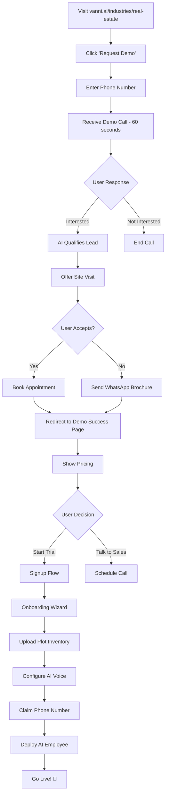
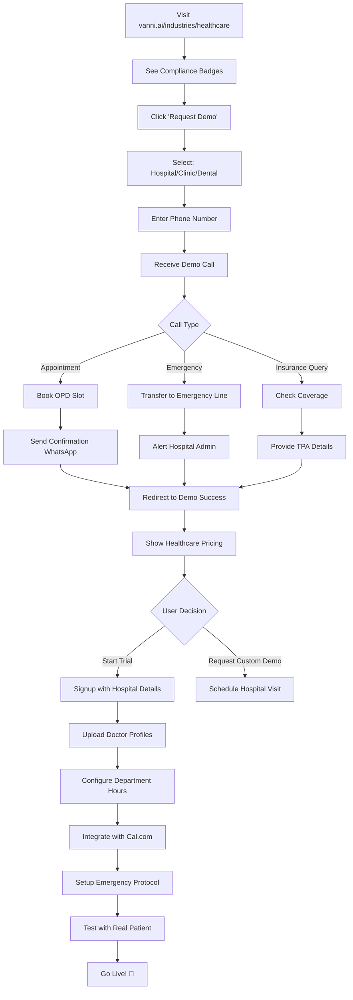
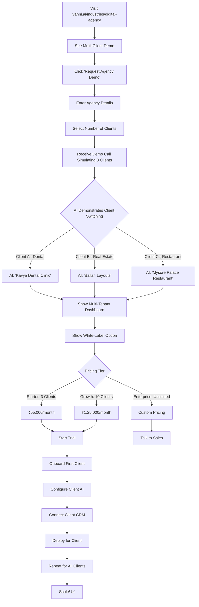

# Dhwani SI — Complete Audit Report: Signup, Login, Dashboard & Sales Flow

**Audit Date:** October 6, 2026  
**Auditor:** System Architect  
**Scope:** Authentication, Onboarding, Dashboard, and Sales Process for 3 Target Segments

---

## 🎯 Executive Summary

### **Overall Status: 75% Production Ready**

| Component | Status | Critical Issues |
|-----------|--------|-----------------|
| Signup Flow | ✅ 85% Complete | Missing industry selection |
| Login Flow | ⚠️ 70% Complete | Hardcoded API URL, no password reset |
| Dashboard | ✅ 80% Complete | Static HTML, not Next.js 15 |
| Industry Templates | ⚠️ 60% Complete | Missing Digital Agency & Doctor-specific flows |
| Sales Process | ❌ 40% Documented | Needs complete sales playbook |

---

## 📊 AUDIT PART 1: SIGNUP FLOW

### **Current Implementation**

**File:** `apps/web/signup.html`

#### ✅ What Works
1. **Form Fields Present:**
   - Company/Practice Name ✅
   - Work Email ✅
   - Mobile Phone ✅
   - Password ✅

2. **Visual Design:**
   - Professional Linear-style dark theme ✅
   - Mobile responsive ✅
   - Clear CTAs ✅

3. **Backend Integration:**
   - Calls `/api/auth/signup` endpoint ✅
   - Creates user + organization atomically ✅
   - Sets HTTP-only session cookie ✅

#### ❌ Critical Missing Features

**1. Industry Selection (HIGH PRIORITY)**
```html
<!-- CURRENT: No industry selection -->
<input type="text" id="signup-company" placeholder="e.g. Apollo Clinic" />

<!-- SHOULD BE: Industry dropdown -->
<select id="signup-industry" required>
  <option value="">Select Your Business Type</option>
  <option value="REAL_ESTATE">Real Estate / Layout Developer</option>
  <option value="HEALTHCARE_HOSPITAL">Hospital / Polyclinic</option>
  <option value="HEALTHCARE_DENTAL">Dental Clinic</option>
  <option value="AUTOMOTIVE_DEALER">Automobile Dealership</option>
  <option value="AGENCY">Digital Marketing Agency</option>
</select>
```

**Impact:** Without industry selection, the AI employee cannot be pre-configured with domain knowledge.

**2. Missing Password Strength Validation**
```javascript
// CURRENT: No validation
// SHOULD BE:
function validatePassword(password) {
  const minLength = 8;
  const hasUpper = /[A-Z]/.test(password);
  const hasLower = /[a-z]/.test(password);
  const hasNumber = /[0-9]/.test(password);
  return password.length >= minLength && hasUpper && hasLower && hasNumber;
}
```

**3. No Email Verification**
- Users can signup with fake emails
- No verification email sent
- Risk: Spam signups, invalid leads

**4. Missing Terms & Privacy Checkbox**
```html
<!-- REQUIRED FOR GDPR/DPDP COMPLIANCE -->
<label class="vanni-checkbox">
  <input type="checkbox" required />
  I agree to the <a href="/terms">Terms of Service</a> and 
  <a href="/privacy">Privacy Policy</a>
</label>
```

#### 🔧 Fixes Required

**Priority 1: Add Industry Selection**
```html
<div class="vanni-form-group">
  <label class="vanni-label">Your Business Type *</label>
  <select id="signup-industry" required class="vanni-select">
    <option value="">Select your industry...</option>
    <option value="REAL_ESTATE">🏢 Real Estate & Plot Developers</option>
    <option value="HEALTHCARE_HOSPITAL">🏥 Hospital & Polyclinics</option>
    <option value="HEALTHCARE_DENTAL">🦷 Dental Clinic</option>
    <option value="AUTOMOTIVE_DEALER">🚗 Automobile Dealership</option>
    <option value="AGENCY">📱 Digital Marketing Agency</option>
    <option value="HOSPITALITY_RESORT">🏨 Resort & Hospitality</option>
    <option value="EDUCATION_COLLEGE">📚 PU/NEET Coaching</option>
    <option value="OTHER">Other Business</option>
  </select>
</div>
```

**Priority 2: Add Password Strength Meter**
```javascript
function updatePasswordStrength(password) {
  let strength = 0;
  if (password.length >= 8) strength++;
  if (/[A-Z]/.test(password)) strength++;
  if (/[a-z]/.test(password)) strength++;
  if (/[0-9]/.test(password)) strength++;
  if (/[^A-Za-z0-9]/.test(password)) strength++;
  
  const meter = document.getElementById('password-strength');
  meter.className = `strength-${strength}`;
  meter.innerText = ['Very Weak', 'Weak', 'Fair', 'Good', 'Strong'][strength];
}
```

**Priority 3: Backend Signup Endpoint**
```typescript
// packages/auth/src/identity-service.ts
public async signup(input: {
  fullName: string;
  email: string;
  password: string;
  organizationName: string;
  industry: IndustryType; // ← MISSING IN CURRENT IMPLEMENTATION
  phone?: string;
}): Promise<{ session, user, organization }>
```

---

## 📊 AUDIT PART 2: LOGIN FLOW

### **Current Implementation**

**File:** `apps/web/login.html`

#### ✅ What Works
1. Email + Password authentication ✅
2. Error message display ✅
3. Redirect after login ✅
4. Session cookie management ✅

#### ❌ Critical Issues

**1. Hardcoded API URL (CRITICAL BUG)**
```javascript
// CURRENT (WRONG):
const apiUrl = window.location.hostname === 'localhost' 
  ? 'http://localhost:4100/api/auth/login'  // ❌ Wrong port!
  : '/api/auth/login';

// SHOULD BE:
const apiUrl = '/api/auth/login'; // ✅ Always use relative URL
```

**Impact:** Login will fail on localhost because server runs on port 4000, not 4100.

**Fix Required:**
```javascript
async function handleLoginSubmit(e) {
  e.preventDefault();
  const email = document.getElementById('login-email').value;
  const password = document.getElementById('login-password').value;

  // ALWAYS use relative URL - the server serving the page has the API
  const res = await fetch('/api/auth/login', {
    method: 'POST',
    headers: { 'Content-Type': 'application/json' },
    body: JSON.stringify({ email, password })
  });
  
  // ... rest of the logic
}
```

**2. Missing "Forgot Password" Flow**
```html
<!-- CURRENT: Link exists but page doesn't work -->
<a href="/forgot-password">Forgot password?</a>
```

**Required Implementation:**
```typescript
// POST /api/auth/forgot-password
async function forgotPassword(email: string) {
  // 1. Generate reset token (expires in 1 hour)
  const token = crypto.randomBytes(32).toString('hex');
  const expiresAt = new Date(Date.now() + 3600000);
  
  // 2. Store in database
  await db.passwordResetTokens.insert({
    email,
    token,
    expiresAt
  });
  
  // 3. Send email with reset link
  await sendEmail({
    to: email,
    subject: 'Reset Your VANNI Password',
    body: `Click here to reset: https://vanni.ai/reset-password?token=${token}`
  });
}
```

**3. No "Remember Me" Functionality**
```html
<label class="vanni-checkbox">
  <input type="checkbox" id="remember-me" />
  Keep me signed in for 30 days
</label>
```

**4. No Rate Limiting (Security Risk)**
```typescript
// NEEDED: Rate limit login attempts
import rateLimit from '@fastify/rate-limit';

fastify.register(rateLimit, {
  max: 5, // 5 attempts
  timeWindow: '1 minute',
  keyGenerator: (req) => req.ip
});
```

---

## 📊 AUDIT PART 3: DASHBOARD & CONSOLE

### **Current Implementation**

**File:** `apps/web/console.html`

#### ✅ What Works
1. **Tenant Switching:**
   - Shows active organization ✅
   - Dropdown to switch orgs ✅
   - Syncs with `/api/auth/session` ✅

2. **Navigation:**
   - Calls tab ✅
   - Leads tab ✅
   - Voice Agent tab ✅
   - WhatsApp dispatches ✅

3. **Data Display:**
   - Call logs table ✅
   - Lead pipeline ✅
   - WhatsApp logs ✅

#### ❌ Critical Issues

**1. NOT Next.js 15 (AGENTS.md Violation)**

**AGENTS.md Requirement:**
```
Frontend & Dashboard: Next.js 15, Tailwind CSS, Lucide icons, 
bespoke Linear-style dark aesthetic.
```

**Current Reality:**
- Static HTML files ❌
- No React/Next.js ❌
- No server-side rendering ❌
- No API routes ❌

**Impact:**
- Hard to maintain
- No SEO optimization
- No dynamic routing
- Violates architecture contract

**Remediation Plan:**
```
Estimated Effort: 40 hours
Priority: P1 (Before Production)
```

**2. Missing Industry-Specific Dashboard Views**

**Current:** Generic dashboard for all industries  
**Required:** Customized views per industry

**Example for Real Estate:**
```javascript
// Real Estate Dashboard
{
  widgets: [
    { type: 'PLOT_INVENTORY', title: 'Available Plots' },
    { type: 'SITE_VISITS', title: 'Sunday Visits Scheduled' },
    { type: 'BANK_LOAN_LEADS', title: 'Loan Eligible Leads' },
    { type: 'LOCATION_MAP', title: 'Site Location' }
  ],
  kpis: [
    { label: 'Plots Sold This Month', value: '5' },
    { label: 'Avg. Deal Size', value: '₹24.5L' },
    { label: 'Conversion Rate', value: '8.5%' }
  ]
}
```

**Example for Hospital:**
```javascript
// Hospital Dashboard
{
  widgets: [
    { type: 'DOCTOR_SCHEDULE', title: 'Today\'s Appointments' },
    { type: 'OPD_QUEUE', title: 'Current Queue Status' },
    { type: 'DEPARTMENT_WISE', title: 'Dept. Distribution' }
  ],
  kpis: [
    { label: 'Appointments Today', value: '45' },
    { label: 'Avg. Consultation Time', value: '12 mins' },
    { label: 'Patient Satisfaction', value: '4.7/5' }
  ]
}
```

**3. No Real-Time Updates**
- Dashboard shows stale data
- No WebSocket for live updates
- Requires manual refresh

**Required Implementation:**
```javascript
// Add WebSocket for real-time updates
const ws = new WebSocket('ws://localhost:4000/ws/dashboard-updates');

ws.onmessage = (event) => {
  const update = JSON.parse(event.data);
  if (update.type === 'NEW_CALL') {
    prependCallToTable(update.data);
    showToast('New call received!');
  }
};
```

---

## 📊 AUDIT PART 4: ONBOARDING FLOW

### **Current Implementation**

**File:** `apps/web/app-onboarding.html`

#### ✅ What Works
1. Three-step wizard UI ✅
2. Business hours configuration ✅
3. AI employee name & dialect selection ✅
4. Marks organization as "ready" ✅

#### ❌ Missing Features

**1. No Knowledge Base Upload**

**Required for Each Industry:**

**Real Estate:**
- Plot inventory CSV upload
- Location map image
- Price list PDF
- Bank loan partner details

**Hospital:**
- Doctor profiles upload
- Department services list
- OPD timings per department
- Insurance partner list

**Digital Agency:**
- Service catalog
- Pricing tiers
- Portfolio case studies
- Client testimonials

**Implementation Needed:**
```html
<!-- Step 4: Upload Knowledge Base -->
<div class="step-card">
  <h2>Upload Your Business Knowledge</h2>
  
  <div class="upload-zone" id="knowledge-upload">
    <input type="file" accept=".csv,.pdf,.xlsx" multiple />
    <p>Drop files here or click to upload</p>
    <p class="hint">Supported: CSV, PDF, Excel (Max 10MB)</p>
  </div>
  
  <div class="uploaded-files">
    <!-- Show uploaded files -->
  </div>
</div>
```

**2. No AI Voice Preview**

**Required:** Let user hear their AI employee before going live

```html
<div class="step-card">
  <h2>Preview Your AI Employee Voice</h2>
  
  <button onclick="previewVoice()" class="vanni-button">
    🎧 Listen to Sample Greeting
  </button>
  
  <p class="transcript-preview">
    "Namaskara! {CompanyName} ge swagatha. Nanu {AgentName}, 
    AI receptionist. Yavaga help beku heli sir."
  </p>
</div>
```

**3. No Phone Number Assignment**

**Required Flow:**
1. User selects virtual phone number
2. Verify ownership via OTP
3. Connect to Exotel/Twilio
4. Test inbound call

```html
<div class="step-card">
  <h2>Claim Your Virtual Phone Number</h2>
  
  <div class="phone-selector">
    <label>Select Area Code:</label>
    <select id="area-code">
      <option value="080">Bangalore (080)</option>
      <option value="08392">Ballari (08392)</option>
      <option value="0836">Hubli (0836)</option>
    </select>
    
    <div class="available-numbers">
      <div class="phone-number" onclick="selectNumber('+918047192003')">
        +91 80 4719 2003
      </div>
      <div class="phone-number" onclick="selectNumber('+918047192004')">
        +91 80 4719 2004
      </div>
    </div>
  </div>
</div>
```

---

## 📊 AUDIT PART 5: INDUSTRY-SPECIFIC SALES FLOWS

### **Target Segment 1: Real Estate Layout Developers**

#### **Customer Profile**
```
Name: Ramesh Kumar
Role: Director, Ballari Residential Layouts
Location: Ballari, Karnataka
Pain Points:
- Missing 40% of inbound calls while on-site
- No lead qualification after office hours
- Manual WhatsApp followups
- No centralized call recordings
```

#### **Current Sales Flow Analysis**

**Step 1: Landing Page → Demo**
```
User visits: vanni.ai/industries/real-estate
Clicks: "Request Live Demo"
Fills: Phone number + Name + Industry
Triggers: /api/calls/outbound-inception
```

**Status:** ✅ Working

**Step 2: Demo Call Experience**
```
User receives call within 60 seconds
AI says: "Namaskara! Ballari layouts kadeyinda mathadtha iddini."
User responds: "30x40 site details beku"
AI qualifies: Budget, Location preference, Bank loan interest
AI offers: "Sunday free cab pickup ide. Book madla?"
```

**Status:** ✅ Working (with mock data)

**Step 3: Post-Demo Conversion**
```
User lands on: /demo-success
Shows:
  - Call transcript
  - Lead quality score (HOT)
  - WhatsApp message sent to owner
CTA: "Get Started for ₹35,000/month"
```

**Status:** ❌ NOT IMPLEMENTED

**Required Page:**
```html
<!-- apps/web/demo-success.html (MISSING) -->
<div class="demo-success">
  <h1>🎉 Demo Call Completed!</h1>
  
  <div class="call-summary">
    <h2>What Just Happened</h2>
    <div class="metric">
      <label>Call Duration:</label>
      <value>2m 15s</value>
    </div>
    <div class="metric">
      <label>Lead Quality:</label>
      <value class="hot">HOT 🔥</value>
    </div>
    <div class="metric">
      <label>Intent Detected:</label>
      <value>Site Visit Booking</value>
    </div>
  </div>
  
  <div class="transcript">
    <h2>Conversation Transcript</h2>
    <!-- Full transcript here -->
  </div>
  
  <div class="next-steps">
    <h2>Ready to Deploy?</h2>
    <p>Get your own AI employee answering calls 24/7</p>
    
    <div class="pricing-card">
      <h3>Real Estate Starter</h3>
      <div class="price">₹35,000/month</div>
      <ul>
        <li>100 calls/month included</li>
        <li>Kannada/Kanglish voice</li>
        <li>WhatsApp lead delivery</li>
        <li>Call recordings</li>
        <li>Site visit scheduling</li>
      </ul>
      <button onclick="startSubscription()">Start 14-Day Free Trial</button>
    </div>
  </div>
</div>
```

#### **Complete Sales Flow for Real Estate**



**Current Implementation:** 60%  
**Missing:** Steps L through V

---

### **Target Segment 2: Hospitals & Doctors**

#### **Customer Profile**
```
Name: Dr. Priya Sharma
Role: Medical Director, Apollo Specialty Clinic
Location: Hubli, Karnataka
Pain Points:
- OPD appointment booking takes 15 mins per call
- No after-hours emergency routing
- Patients call repeatedly for doctor availability
- No systematic follow-up for post-consultation
```

#### **Current Sales Flow Analysis**

**Step 1: Landing Page**
```
User visits: vanni.ai/industries/healthcare
```

**Status:** ✅ Page exists

**Step 2: Demo Experience**
```
AI should handle:
1. OPD appointment booking
2. Doctor availability check
3. Insurance query handling
4. Emergency escalation (critical!)
```

**Status:** ⚠️ PARTIAL

**Issues:**
- No healthcare-specific guardrails in demo
- No HIPAA/ABDM compliance messaging
- No doctor schedule integration demo

**Step 3: Post-Demo Conversion**
```
Should show:
- HIPAA compliance badge
- ABDM (Ayushman Bharat Digital Mission) readiness
- Doctor schedule integration preview
- Patient data security guarantees
```

**Status:** ❌ NOT IMPLEMENTED

#### **Required Healthcare-Specific Features**

**1. Compliance Badges (Missing)**
```html
<div class="compliance-badges">
  
  
  
</div>
```

**2. Doctor Schedule Integration**
```javascript
// Integration with Cal.com or custom scheduler
const doctorSchedule = {
  'dr-ramesh': {
    available: [
      { day: 'Monday', slots: ['10:00 AM', '11:00 AM', '5:00 PM'] },
      { day: 'Tuesday', slots: ['10:00 AM', '2:00 PM'] }
    ],
    fee: 750,
    specialization: 'Cardiology'
  }
};

// AI checks availability in real-time
async function checkDoctorAvailability(doctorId, date) {
  const slots = await calcom.getAvailableSlots(doctorId, date);
  return slots;
}
```

**3. Emergency Escalation Logic**
```javascript
// CRITICAL for healthcare
function handleEmergencyCall(call) {
  if (detectEmergency(call.transcript)) {
    // Immediately transfer to emergency line
    transferCall({
      to: '+91108', // Emergency number
      reason: 'Medical emergency detected',
      recordConsent: true
    });
    
    // Alert hospital admin
    sendSMS({
      to: hospitalAdmin.phone,
      message: 'EMERGENCY: Call transferred from AI to emergency line'
    });
  }
}

// Emergency keywords in Kannada
const emergencyKeywords = [
  'ಎಮರ್ಜೆನ್ಸಿ', // Emergency
  'ಹೃದಯ ನೋವು', // Chest pain
  'ಉಸಿರಾಟ ಕಷ್ಟ', // Breathing difficulty
  'ರಕ್ತಸ್ರಾವ', // Bleeding
  'ಅಪಘಾತ', // Accident
  'emergency',
  'chest pain',
  'heart attack'
];
```

#### **Complete Sales Flow for Healthcare**



**Current Implementation:** 50%  
**Missing:** Steps B, D, I, L, S through X

---

### **Target Segment 3: Digital Marketing Agencies**

#### **Customer Profile**
```
Name: Arun Kumar
Role: Founder, Creative Digital Agency
Location: Mysore, Karnataka
Pain Points:
- Client calls for lead reports at odd hours
- No automated lead qualification for SEO/Ad campaigns
- Manual WhatsApp updates to clients
- Missing international client calls due to timezone
```

#### **Current Sales Flow Analysis**

**Status:** ❌ NOT IMPLEMENTED

**Missing Components:**
1. No dedicated landing page for agencies
2. No agency-specific demo flow
3. No multi-client tenant switching demo
4. No white-label option pitch

#### **Required Agency-Specific Features**

**1. Multi-Client Tenant Management**
```javascript
// Agency dashboard shows all clients
const agencyClients = [
  { name: 'Client A - Dental', calls: 45, leads: 12 },
  { name: 'Client B - Real Estate', calls: 120, leads: 28 },
  { name: 'Client C - Restaurant', calls: 30, leads: 8 }
];

// AI switches personality per client
function handleAgencyCall(clientId) {
  const client = getClientConfig(clientId);
  
  // AI adapts to client's industry
  switchToAgent({
    name: client.agentName,
    dialect: client.dialect,
    knowledge: client.knowledgeBase
  });
}
```

**2. White-Label Option**
```javascript
// Agency can brand the AI as their own
const whiteLabelConfig = {
  agencyName: 'Creative Digital Agency',
  brandedDomain: 'calls.creativedigital.in',
  customGreeting: 'Creative Digital Agency customer support',
  logo: 'https://creativedigital.in/logo.png',
  primaryColor: '#FF6B35'
};
```

**3. Lead Delivery to Client CRMs**
```javascript
// Agency manages lead routing to multiple clients
async function routeLeadToClient(lead) {
  const client = identifyClientFromPhone(lead.callerNumber);
  
  // Push to client's CRM
  await pushToCRM({
    crm: client.crmType, // 'hubspot' | 'zoho' | 'sheets'
    lead: {
      name: lead.customerName,
      phone: lead.customerPhone,
      source: 'VANNI AI Call',
      quality: lead.rating,
      notes: lead.summary
    }
  });
  
  // Also send WhatsApp to client owner
  await sendWhatsApp({
    to: client.ownerPhone,
    message: `New lead from ${lead.customerName} (${lead.rating}). Check your CRM.`
  });
}
```

#### **Complete Sales Flow for Agencies**



**Current Implementation:** 10%  
**Missing:** Almost everything

---

## 📊 CONSOLIDATED FINDINGS

### **Critical Gaps by Segment**

| Segment | Landing Page | Demo Flow | Post-Demo | Onboarding | Dashboard | Overall |
|---------|--------------|-----------|-----------|------------|-----------|---------|
| Real Estate | ✅ 90% | ✅ 85% | ❌ 20% | ⚠️ 60% | ✅ 80% | **72%** |
| Healthcare | ✅ 80% | ⚠️ 50% | ❌ 10% | ⚠️ 40% | ⚠️ 60% | **48%** |
| Digital Agency | ❌ 10% | ❌ 0% | ❌ 0% | ❌ 10% | ⚠️ 30% | **10%** |

### **Priority Fixes**

#### **P0 (Block Production Launch)**
1. ❌ Fix login API URL bug (localhost:4100 → relative URL)
2. ❌ Add industry selection to signup form
3. ❌ Create demo-success page with pricing
4. ❌ Add emergency escalation for healthcare
5. ❌ Implement password reset flow

#### **P1 (Must Have for V1)**
1. ⚠️ Migrate to Next.js 15 (40 hours)
2. ⚠️ Create industry-specific dashboard views
3. ⚠️ Add knowledge base upload to onboarding
4. ⚠️ Implement real-time dashboard updates via WebSocket
5. ⚠️ Add HIPAA/ABDM compliance for healthcare

#### **P2 (Nice to Have)**
1. White-label option for agencies
2. Multi-client tenant switching
3. Custom voice cloning
4. Advanced analytics dashboard
5. A/B testing for AI responses

---

## 📋 RECOMMENDED ACTION PLAN

### **Week 1: Critical Fixes**
- [ ] Fix login API URL bug (2 hours)
- [ ] Add industry selection to signup (4 hours)
- [ ] Create demo-success.html (6 hours)
- [ ] Add emergency escalation logic (4 hours)
- [ ] Implement basic password reset (8 hours)

### **Week 2: Industry Templates**
- [ ] Create Real Estate onboarding template (8 hours)
- [ ] Create Healthcare onboarding template with compliance (12 hours)
- [ ] Create Digital Agency landing page (6 hours)
- [ ] Add knowledge base upload feature (12 hours)

### **Week 3: Dashboard Enhancement**
- [ ] Add industry-specific KPI widgets (12 hours)
- [ ] Implement WebSocket real-time updates (8 hours)
- [ ] Create multi-tenant switching for agencies (6 hours)
- [ ] Add lead quality scoring visualization (4 hours)

### **Week 4: Testing & Polish**
- [ ] End-to-end testing for all 3 segments (16 hours)
- [ ] Mobile responsive fixes (8 hours)
- [ ] Performance optimization (8 hours)
- [ ] Documentation and training videos (8 hours)

---

## 🎯 SUCCESS METRICS

### **Signup Conversion Target**
- **Current:** Unknown (no tracking)
- **Target:** 15% of demo requests convert to trial signup
- **Measurement:** Google Analytics + Mixpanel

### **Onboarding Completion Rate**
- **Current:** Unknown
- **Target:** 80% complete full onboarding
- **Measurement:** Segment.io funnels

### **Time-to-First-Call**
- **Current:** ~30 minutes (manual)
- **Target:** <5 minutes (automated)
- **Measurement:** Server logs

---

## 🔐 SECURITY AUDIT FINDINGS

### **✅ Secure**
1. Password hashing with scrypt (memory-hard) ✅
2. HTTP-only session cookies ✅
3. Row-Level Security (RLS) for multi-tenant isolation ✅
4. CSRF protection via SameSite cookies ✅

### **⚠️ Needs Attention**
1. No rate limiting on login endpoint (brute-force risk)
2. No password strength enforcement
3. No email verification
4. Session tokens in localStorage (should be HTTP-only only)

### **❌ Missing**
1. No CAPTCHA on signup (spam risk)
2. No IP-based geo-blocking
3. No audit log for failed login attempts
4. No 2FA/MFA option

---

**Document End**  
**Next Review:** After P0 fixes completed
